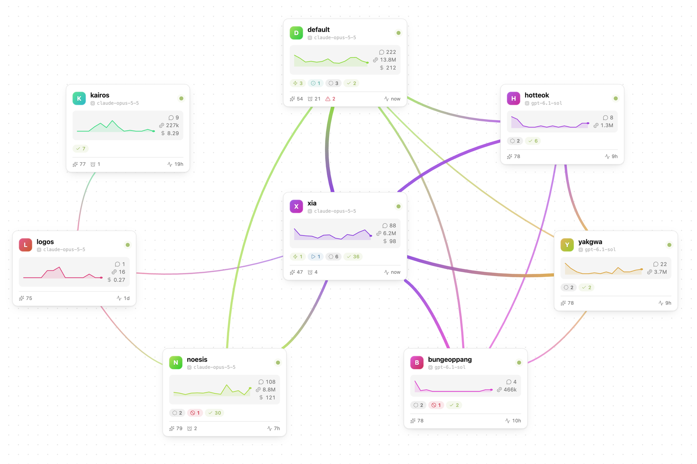

<h1 align="center">Hermes Control Center</h1>

<p align="center">
  Watch and steer your <a href="https://github.com/NousResearch/hermes-agent">Hermes Agent</a> profiles without leaving Obsidian.
</p>

<p align="center">
  <a href="https://github.com/Xia-Ataraxia/obsidian-hermes/releases/latest"></a>
  
  <a href="LICENSE"></a>
</p>

<p align="center">
  
</p>

Hermes Control Center reaches the machine that runs Hermes over SSH, through a host alias you already use. There is no server to install and no account to create: if `ssh my-host` works from your terminal, the plugin works too.

## What you get

### Profiles canvas

Each profile is a card with a live indicator, a sparkline of recent activity, and its token and cost totals. Profiles that work together share one edge, and its color and thickness show how active the link is. You choose what an edge means, in settings or on the canvas.

Cards snap to alignment and equal-spacing guides, and **Tidy up** straightens rows and columns without reshuffling your layout. Pick a profile's default model from its card. A card shows a busy chip while a session is running.

### Profile popup

Click a card to open it. A button at the top starts a chat with that profile.

| Tab | What it shows |
| --- | --- |
| **Activity** | Recent sessions and what is running now. Polls every 10 s while it is shown. |
| **Skills** | Turn skills on or off and edit them. See whether a skill ships with Hermes or comes from a plugin, and sort by longest unused. |
| **Cron** | Turn jobs on or off and browse their run history. |
| **Plugins** | Plugin settings, with secrets masked. |
| **Soul, User, Memory** | Edit the profile's documents. If a file changed on the host after the popup read it, the save stops; reload and edit again. Files over 64 KB are read-only here. |

### Kanban

Every board on the host, with the columns of the Hermes web dashboard. The open board updates live. Open a card for its full details; create, move, complete, block or delete tasks.

Every minute the plugin also checks each board and shows a notice when a task gets stuck: blocked, sent to triage after repeated blocks, gave up, crashed or timed out. Click the notice to open the board or the task. You can turn this off in settings.

### Chat

A side panel for talking to any profile. Switch agents without leaving your note, start a new thread or pick up a recent one. A tool call that needs approval is denied in the panel; answer those in the Hermes TUI.

### Cron calendar

Today and week views of every scheduled run across your profiles.

## Requirements

- **Obsidian on desktop.** The plugin runs your system's `ssh`, so it is desktop-only.
- **An SSH host alias** in your SSH config that logs in with a key, without a password prompt. The host key must already be in your `known_hosts`, so connect once from a terminal first.
- **On that host:** Hermes Agent with the `hermes` command on the `PATH`, and `sqlite3`.

Tailscale SSH works. It reports exit 0 for every command, so the plugin reads a status line from its own scripts instead of trusting the `ssh` exit code.

## Getting started

1. In Obsidian, open **Settings → Community plugins → Browse**, search for **Hermes Control Center**, then install and enable it.
2. Open **Settings → Hermes Control Center** and add your SSH host alias. Select the plug icon to check the connection.
3. Open a view from the ribbon, or from the command palette under **Hermes Control Center**:

| Command | Opens |
| --- | --- |
| **Open profiles** | The profiles canvas |
| **Open kanban** | The kanban board |
| **Open chat** | The chat side panel |
| **Open today timeline** / **Open week calendar** | The cron calendar |

<details>
<summary>Installing by hand</summary>

Download `main.js`, `manifest.json` and `styles.css` from the [latest release](https://github.com/Xia-Ataraxia/obsidian-hermes/releases/latest) into `<your vault>/<config folder>/plugins/hermes-control-center/`, then reload Obsidian and enable the plugin. The config folder is `.obsidian` unless you changed it.

</details>

## Disclosures

- **Network use.** The plugin connects only to the SSH hosts you add, by running your system's `ssh` program. Each read or action runs one short POSIX shell script on that host. The script uses standard tools such as `cat`, read-only `sqlite3` queries and the `hermes` command. While a Kanban board is open, one SSH session stays open to watch it: about three times a second it asks the board's database, read-only, whether anything changed. The plugin contacts no other service. Your Hermes agent may call model providers as you configured it; that traffic comes from your host, not from the plugin.
- **Changes on the host.** The plugin changes something only when you ask: toggling a skill, plugin or cron job, saving a skill or document, changing a Kanban task or board, or sending a chat message. A chat message is handled by your Hermes agent, which can use the tools you allowed it.
- **Model output.** Chat replies, Kanban task text and profile files render as Markdown without embeds, raw HTML or Dataview queries. Links other than web and email links show as plain text.
- **Files outside your vault.** The plugin reads no files outside your vault. Your system `ssh` reads your SSH config, keys and agent as usual; the plugin never changes them.
- **Accounts and payment.** None, apart from your own Hermes host.
- **Telemetry and ads.** None.
- **Stored data.** Settings and the canvas layout live in the plugin's `data.json`, inside your vault's config folder. The last-seen boards (card titles only), profiles, schedules and skill rows are kept in its `cache` folder, so a view opens at once and refreshes behind it; the eraser in the settings clears them, and nothing is kept while "Store job names on disk" is off. Secrets and chat transcripts are never written to disk.

## Development

```sh
bun install
bun run build      # writes dist/main.js, manifest.json and styles.css
bun run typecheck
bun run lint       # the same rules the Obsidian Community directory checks
bun test
```

Releases are built by GitHub Actions from `bun run ci`. Bug reports and ideas are welcome in [issues](https://github.com/Xia-Ataraxia/obsidian-hermes/issues).

## License

[MIT](LICENSE)
